<div align="center">


# Shiftbell

**The time-in alarm you cannot miss and cannot dismiss unread.**

Rings before work to time in and after work to time out, plus any alarm you add (a standup, a client call), on Windows and Android.
It stays until you confirm you actually did it.


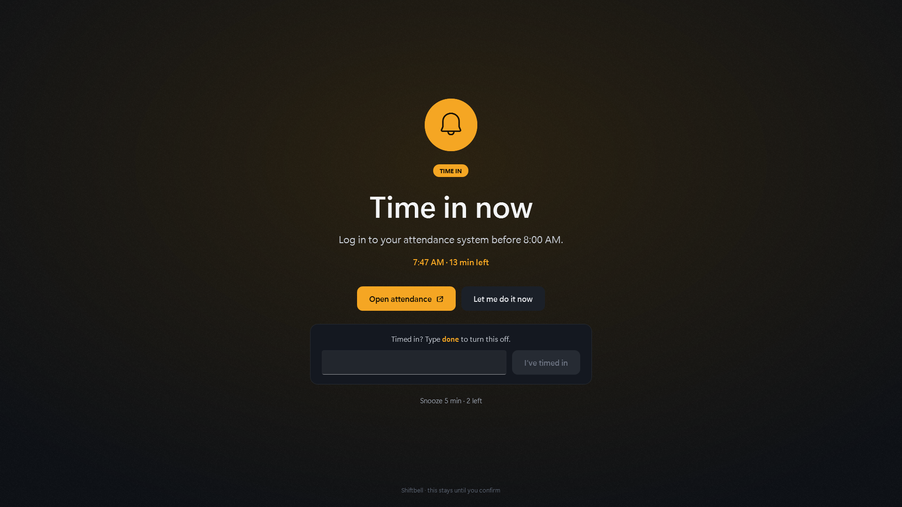

</div>

## Why

Most alarms ring through a notification, and a notification is easy to lose.
Do Not Disturb, a full-screen game, a muted PC or a phone on silent each swallow it, and a quick swipe dismisses it without a thought.
Shiftbell takes over the screen instead, and only goes away when you type **done**, or press Dismiss for alarms you mark as less strict.

## Highlights

| | Windows | Android |
|---|---|---|
| Time in, time out, and any alarm you add: repeat on days or ring once on a date | ✓ | ✓ |
| Rings through Do Not Disturb, Focus and full-screen apps | ✓ | ✓ |
| Rings on a muted PC or a silent phone | ✓ | ✓ |
| Wakes a sleeping device for the alarm | ✓ | ✓ |
| Rings a missed alarm late after the device was off | ✓ | ✓ |
| Per alarm: type **done** to stop it, or a single Dismiss button; snooze is limited | ✓ | ✓ |
| "Let me do it now": steps aside for 3 minutes, then returns | ✓ | ✓ |
| One-click link per alarm: your attendance page, a meeting link | ✓ | ✓ |
| Starts soft and builds up, never blasts your ears | ✓ | ✓ |
| Alarms you add, edit or delete appear on every paired device | ✓ | ✓ |
| Confirm on one device, every paired device stops | ✓ | ✓ |

## Screenshots

<table>
  <tr>
    <td align="center">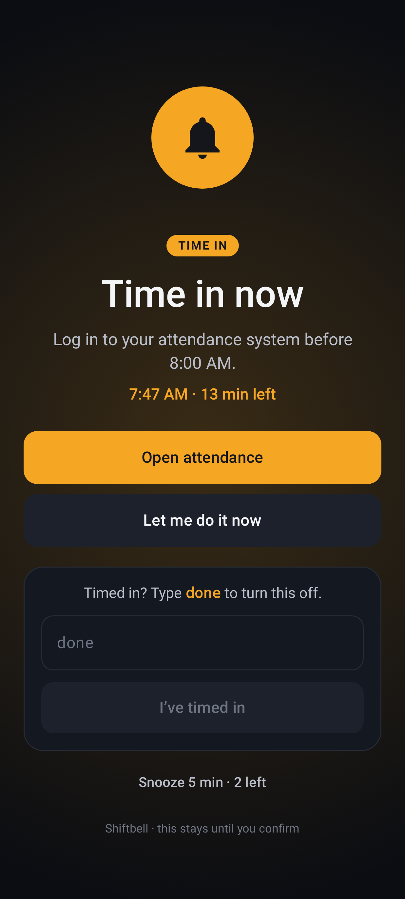<br /><sub>Time in</sub></td>
    <td align="center">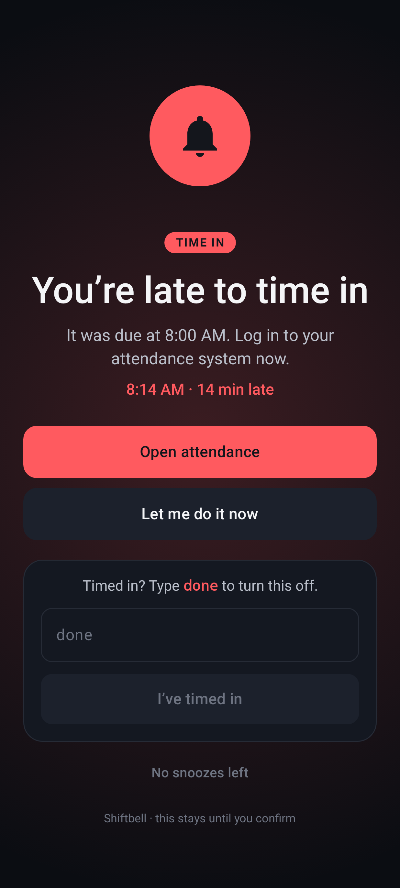<br /><sub>Late</sub></td>
    <td align="center">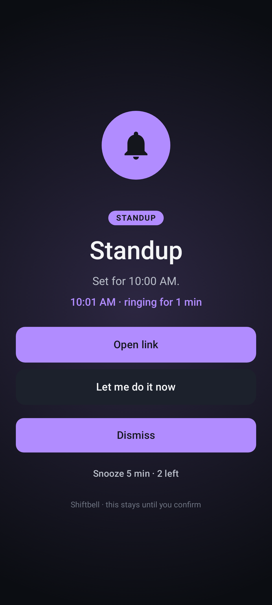<br /><sub>An added alarm</sub></td>
    <td align="center">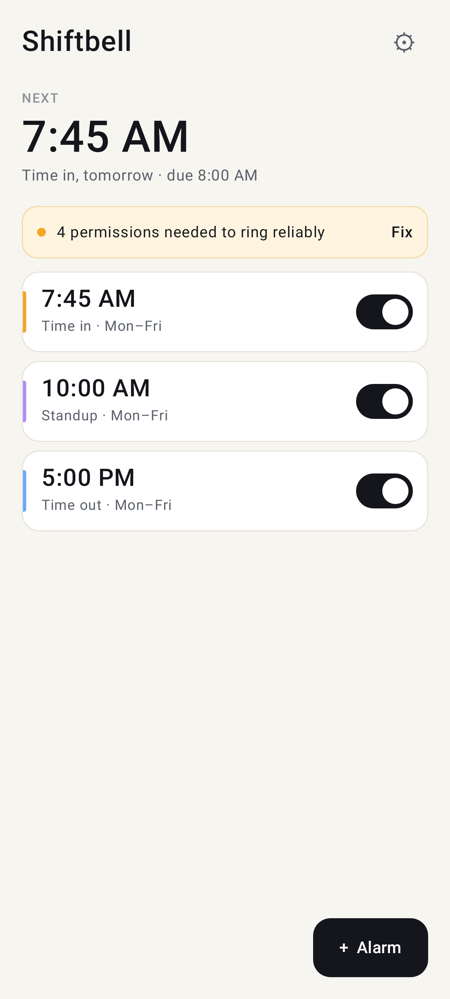<br /><sub>Home</sub></td>
  </tr>
  <tr>
    <td align="center">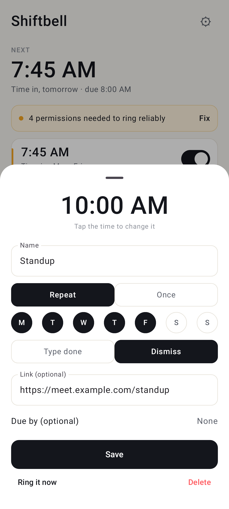<br /><sub>Add or edit</sub></td>
    <td align="center">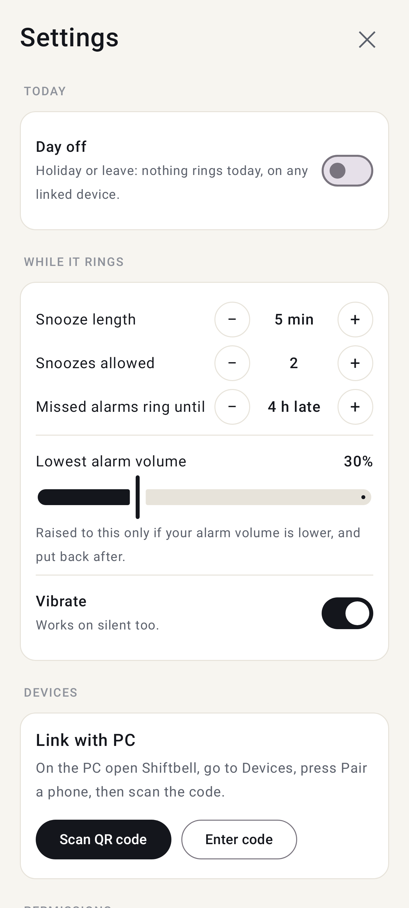<br /><sub>Settings</sub></td>
  </tr>
</table>

<table>
  <tr>
    <td align="center">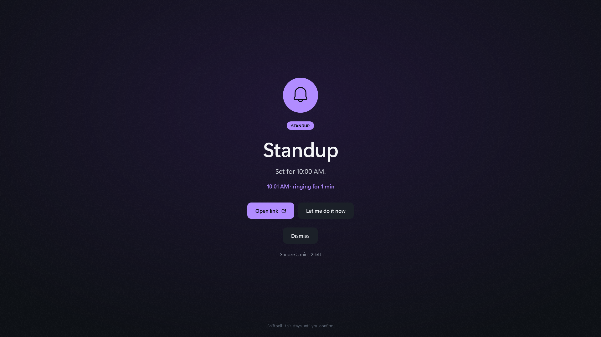<br /><sub>An added alarm on Windows</sub></td>
    <td align="center">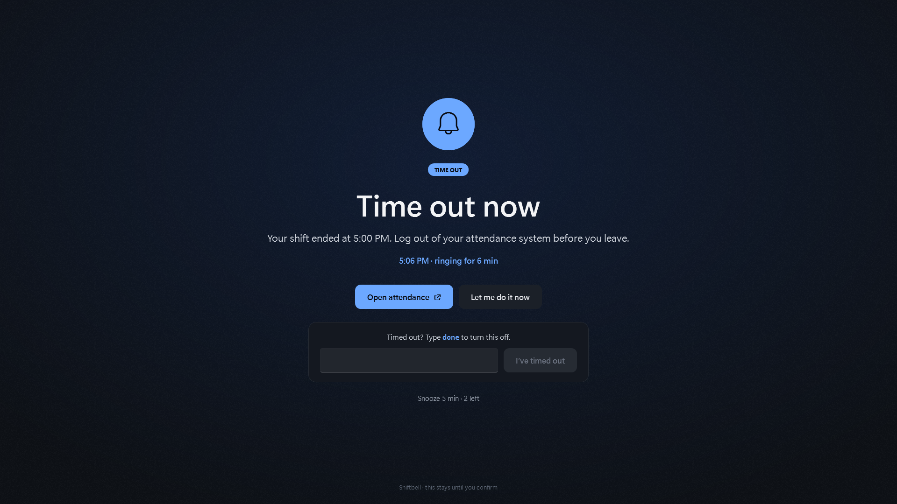<br /><sub>Time out</sub></td>
  </tr>
  <tr>
    <td align="center">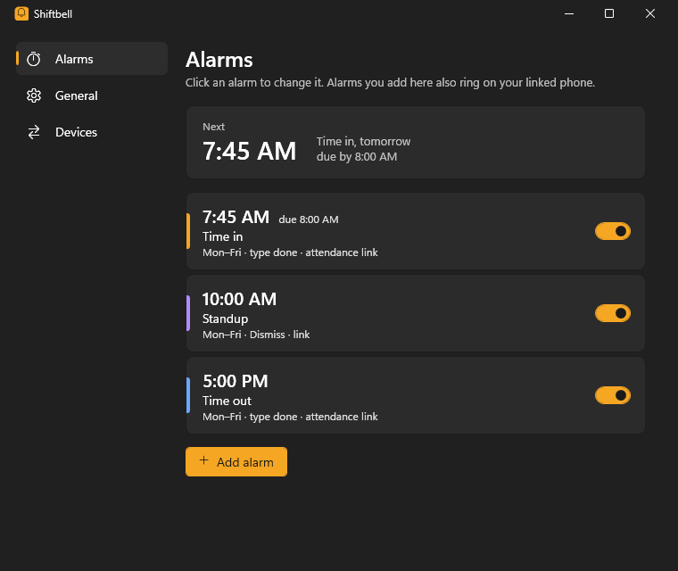<br /><sub>Alarms</sub></td>
    <td align="center">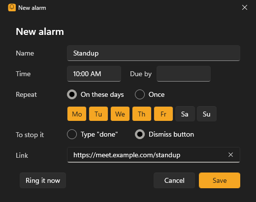<br /><sub>Add or edit</sub></td>
  </tr>
</table>

## How it works

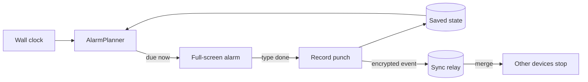

- **Decided from state, not timers.** Every second (Windows) or at each system alarm (Android), a pure planner reads the saved state and the clock, so sleep, reboots and clock changes cannot lose an alarm.
- **Same rules everywhere.** The planner and every word on the alarm live in a tested core, mirrored in C# and Kotlin.
- **Sync is end-to-end encrypted.** Devices pair by QR code and derive the keys locally; the relay stores ciphertext it cannot read. Alarm definitions merge by newest edit, confirms and snoozes merge in any order. No network never stops an alarm from ringing. See [docs/sync.md](docs/sync.md) and [docs/decisions/0002-alarm-list.md](docs/decisions/0002-alarm-list.md).

## Getting started

Download from the [latest release](https://github.com/iamprincejkc/shiftbell/releases/latest):

| Platform | File | Notes |
|---|---|---|
| Windows 10/11 (x64) | `Shiftbell-Setup-<version>.exe` | Per-user install, no admin. Unsigned, so SmartScreen asks once: **More info, Run anyway** |
| Android 13+ | `Shiftbell-<version>.apk` | Allow installs from your browser or file manager when asked |

To build from source instead, see [docs/windows.md](docs/windows.md) and [docs/android.md](docs/android.md).

Default schedule: time in rings 7:45 AM (due 8:00), time out rings 5:00 PM, Monday to Friday.
Add more alarms with **Add alarm** (Windows) or **+ Alarm** (Android); pair your devices under Devices.
Upgrading from 0.3 keeps your times, link and punch history.

The apps sync through a small relay endpoint (`/api/shiftbell/{channel}`, two routes on a Nuxt site).
To run your own, point the Windows app at it with `SHIFTBELL_SYNC_URL` and change `RELAY` in `android/app/.../PhoneSync.kt`.

## Repository

| Path | Contents |
|---|---|
| `src/Shiftbell.Core` | Planner, alarm wording, settings, state, sync protocol (no UI) |
| `src/Shiftbell` | Windows app: tray, alarm windows, settings, startup task |
| `tests/` | xUnit tests for the core |
| `android/core` | The same core in Kotlin, with JUnit tests |
| `android/app` | Android app: alarm service, alarm screen, settings |
| `docs/` | Platform guides, sync protocol, decisions |
| `tools/` | Install, uninstall and icon scripts |

## Development

```bash
dotnet test Shiftbell.slnx
```

```bash
cd android && ./gradlew :core:test :app:lintDebug
```

Warnings are errors on both platforms.
Both apps check their encryption against the same independent test vectors in [docs/sync.md](docs/sync.md), byte for byte.

## License

[MIT](LICENSE)
